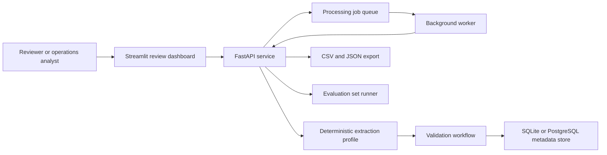

# Document Intelligence Workbench

Document Intelligence Workbench is a local-first document operations system that extracts structured fields from invoices and contracts, assigns confidence scores, validates business rules, routes low-confidence outputs for human review, and exports clean JSON/CSV records.

## Business Use Case

Back-office teams still spend substantial time on manual data entry and correction for invoices, contract metadata, and operational forms. This project demonstrates a production-shaped workflow that turns raw document text into validated structured records with review controls.

Client persona: operations, finance shared services, procurement, legal operations, and document processing teams.

Business value:

- Reduces manual data-entry time for recurring document streams.
- Reduces downstream reconciliation risk by validating totals and contract date logic.
- Improves auditability through confidence scoring and review-required status.

## Architecture



See [docs/architecture.md](docs/architecture.md) for local and Azure-ready diagrams.

## Local Quick Start

```bash
cd 05-document-intelligence-workbench
python3.12 -m venv .venv
.venv/bin/pip install -r requirements.txt
cp .env.example .env
.venv/bin/python scripts/migrate_database.py
.venv/bin/python demo/seed_data.py
.venv/bin/uvicorn docint_workbench.api:app --host 127.0.0.1 --port 8005
```

Optional dashboard:

```bash
.venv/bin/streamlit run dashboard/app.py --server.address 127.0.0.1 --server.port 8512
```

Optional queue worker:

```bash
.venv/bin/python scripts/run_queue_worker.py --continuous --poll-seconds 2
```

Example API calls:

```bash
curl http://127.0.0.1:8005/health

curl -X POST http://127.0.0.1:8005/documents/process \
  -H "X-API-Key: local-reviewer-key" \
  -H "Content-Type: application/json" \
  -d '{
    "file_name":"invoice-sample.txt",
    "document_type":"invoice",
    "content":"Vendor: Apex Office Supplies\nInvoice Number: INV-2026-0042\nInvoice Date: 2026-04-29\nSubtotal: 1250.00\nTax: 125.00\nTotal: 1375.00\nCurrency: USD"
  }'

curl -X POST http://127.0.0.1:8005/documents/process-async \
  -H "X-API-Key: local-reviewer-key" \
  -H "Content-Type: application/json" \
  -d '{
    "file_name":"invoice-async.txt",
    "document_type":"invoice",
    "content":"Vendor: Apex Office Supplies\nInvoice Number: INV-2026-0043\nInvoice Date: 2026-04-30\nSubtotal: 500.00\nTax: 50.00\nTotal: 550.00\nCurrency: USD"
  }'

curl -F "file=@demo/reference_documents.md" \
  -H "X-API-Key: local-reviewer-key" \
  "http://127.0.0.1:8005/documents/upload?document_type=invoice"

curl -H "X-API-Key: local-reviewer-key" http://127.0.0.1:8005/metrics/summary
curl -H "X-API-Key: local-reviewer-key" http://127.0.0.1:8005/metrics/queue
curl -H "X-API-Key: local-reviewer-key" http://127.0.0.1:8005/metrics/prometheus
curl -H "X-API-Key: local-reviewer-key" http://127.0.0.1:8005/documents/review-queue
curl -H "X-API-Key: local-reviewer-key" "http://127.0.0.1:8005/jobs?status=pending"
curl -H "X-API-Key: local-reviewer-key" http://127.0.0.1:8005/audit/events

# AUTH_MODE=api_key
curl -X POST -H "X-Admin-Token: local-admin-token" http://127.0.0.1:8005/evaluation/run

# AUTH_MODE=oidc (admin-scoped bearer token)
curl -X POST \
  -H "Authorization: Bearer <admin-jwt>" \
  http://127.0.0.1:8005/evaluation/run
```

## Validation Workflow

1. Process invoice or contract text through `/documents/process`, queue it through `/documents/process-async`, or upload binary files through `/documents/upload`.
2. Inspect confidence values per extracted field.
3. Review low-confidence or failed validation records.
4. Apply reviewer corrections through `/documents/{id}/review`.
5. Export clean results through `/documents/{id}/export?export_format=json|csv`.

## Screenshots

- `demo/workbench-dashboard.png`
- `demo/workbench-review-table.png`
- `demo/workbench-export.png`

## Environment Variables

Core local variables:

- `DOCINT_DATABASE_PATH`: local SQLite metadata path.
- `DOCINT_DATABASE_BACKEND`: `sqlite` (default) or `postgres`.
- `DOCINT_DATABASE_URL`: required when `DOCINT_DATABASE_BACKEND=postgres`.
- `LOW_CONFIDENCE_THRESHOLD`: threshold for review-required flags.
- `MAX_UPLOAD_CHARS`: payload size safety limit.
- `MAX_UPLOAD_BYTES`: upload file size safety limit.
- `QUEUE_MAX_ATTEMPTS`: maximum worker attempts before moving a job to dead-letter status.
- `QUEUE_RETRY_BASE_SECONDS`: base retry delay in seconds (exponential backoff).
- `QUEUE_RETRY_MAX_SECONDS`: cap for retry delay in seconds.
- `ENABLE_LOCAL_OCR`: enables OCR for image uploads (`png`, `jpg`, `tiff`) using local Tesseract.
- `AUTH_ENABLED`: enables reviewer API-key checks.
- `AUTH_MODE`: `api_key` (default) or `oidc`.
- `REVIEWER_API_KEYS`: comma-separated reviewer API keys.
- `REVIEWER_SCOPE_MAP`: reviewer-to-domain mapping such as `reviewer-a:invoice;reviewer-b:contract`.
- `OIDC_ISSUER`, `OIDC_AUDIENCE`, `OIDC_ALGORITHMS`, `OIDC_JWKS_URL`: OIDC token verification configuration.
- `OIDC_HS256_SHARED_SECRET`: optional shared secret for HS algorithms (recommended only for local/CI testing).
- `OIDC_ROLE_CLAIM`, `OIDC_SUBJECT_CLAIM`, `OIDC_ROLE_SCOPE_MAP`: role extraction and domain scope mapping for OIDC mode.
- `ADMIN_TOKEN`: admin token required for `/evaluation/run` when `AUTH_MODE=api_key`.
- `LLM_PROVIDER`: `mock`, `openai`, or `azure`.
- `LOG_LEVEL`: structured application log level (`INFO` default).
- `DASHBOARD_ALLOW_SECRET_PREFILL`: `false` by default; set `true` only for controlled local demos if dashboard auth fields should prefill from env values.

Azure-ready placeholders are included in `.env.example` and remain optional for local mode.

## Metrics And Evaluation

Implemented operational metrics:

- total processed documents
- documents requiring human review
- average extraction confidence
- evaluation pass rate
- average field match rate on reference data

## Security Notes

- No secrets are committed.
- `.env.example` contains placeholders only.
- Local storage uses SQLite for deterministic demo runs.
- Azure credential-dependent integrations are separated from local runtime.

## Azure Deployment Notes

Forward deployment path:

- Azure AI Document Intelligence for OCR and layout extraction.
- Azure OpenAI for structured extraction prompts.
- Azure Blob Storage for source documents.
- Azure Database for PostgreSQL/Cosmos DB for managed metadata.
- Azure Container Apps + Application Insights for runtime and telemetry.

See [docs/deployment.md](docs/deployment.md) and [docs/production-readiness.md](docs/production-readiness.md).
Operational references:
- [docs/alerting.md](docs/alerting.md)
- [docs/slo-runbook.md](docs/slo-runbook.md)

## Production Execution Plan

Use [docs/execution-checklist.md](docs/execution-checklist.md) as the implementation tracker for production hardening and public release readiness.

Repository governance and release policy files:

- [LICENSE](LICENSE)
- [CONTRIBUTING.md](CONTRIBUTING.md)
- [CODE_OF_CONDUCT.md](CODE_OF_CONDUCT.md)
- [SECURITY.md](SECURITY.md)
- [CHANGELOG.md](CHANGELOG.md)

## Implementation Summary

This phase delivers a runnable local-first backend and review dashboard, deterministic extraction profiles, validation rules, export endpoints, evaluation runner, seed data, tests, CI workflow, Docker runtime files, and production-oriented documentation. Cloud integrations are represented with Azure-ready configuration placeholders and external verification script hooks.
