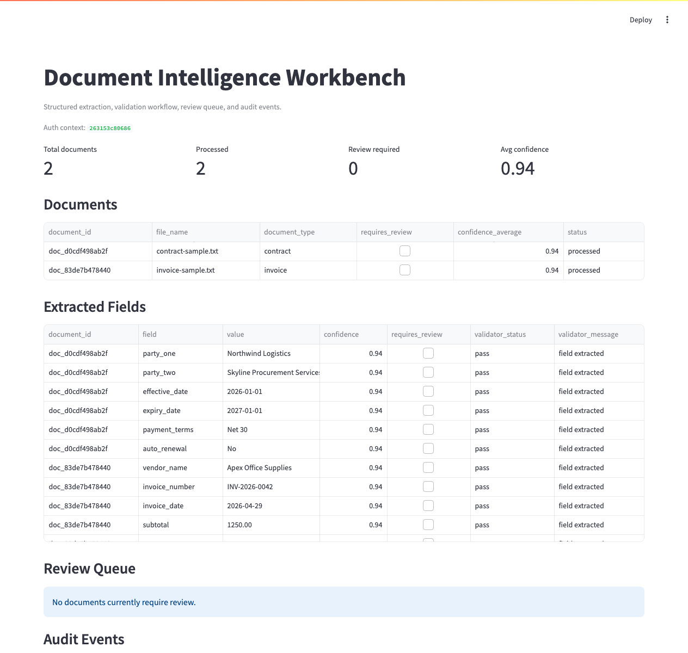
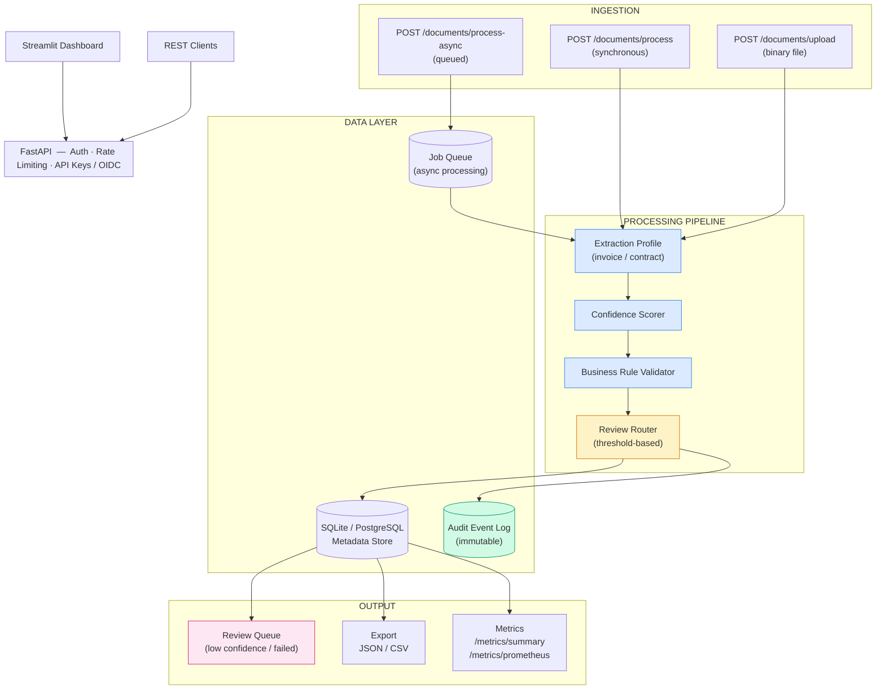
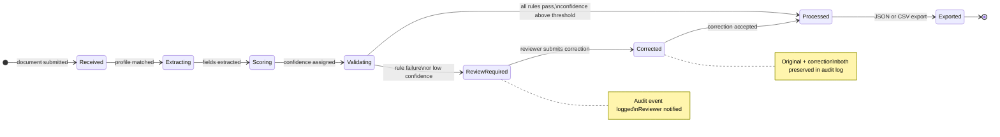

# Document Intelligence Workbench

> Structured data extraction from invoices and contracts — with confidence scoring, business rule validation, human review routing, and clean JSON/CSV export.


---

## The Problem

Back-office teams in finance, legal, and operations spend significant time manually keying data from invoices and contracts into downstream systems. The work is repetitive, error-prone, and produces no audit record of what was extracted, what was corrected, or why.

The result is a reconciliation problem: totals that don't match, contract dates that contradict each other, and no traceable history of who changed what.

This platform extracts structured fields from document text, assigns a confidence score to every field, validates the output against business rules, and routes low-confidence or failed records to a human reviewer — before anything reaches a downstream system.

---

## What It Does

- **Extracts structured fields from invoices and contracts** — vendor name, invoice totals, contract parties, dates, payment terms — with a confidence score per field
- **Validates extracted data against configurable business rules** — invoice totals must match subtotal plus tax; contract expiry must be after effective date; required fields must be present
- **Routes low-confidence and failed records to a review queue** — reviewers see exactly which fields need attention and why, then submit corrections that are logged to an immutable audit trail

---

## Dashboard



*Extraction metrics, per-document confidence scores, field-level validation results, and review queue — all in one view.*

---

## System Architecture



---

## Document Processing Pipeline



---

## Key Capabilities

| Capability | Detail |
|------------|--------|
| **Confidence scoring** | Every extracted field carries a confidence value — low-confidence fields are automatically flagged before downstream export |
| **Configurable validation rules** | Invoice totals must reconcile; contract dates must be logically ordered; required fields must be present — rules are profile-driven, not hardcoded |
| **Human review queue** | Low-confidence and failed records surface in the review queue with field-level detail — reviewers correct in place, not in a spreadsheet |
| **Immutable audit trail** | Every extraction, validation result, and reviewer correction is appended to an ordered event log |
| **Async processing** | Documents can be queued for background processing — job status is queryable; worker uses exponential backoff on failure |
| **Auth — API key and OIDC** | Reviewer API keys with domain scope mapping; OIDC bearer token support for enterprise SSO integration |
| **Prometheus metrics** | Operational metrics exposed at `/metrics/prometheus` — total documents, review rate, average confidence, evaluation pass rate |
| **Clean export** | Validated records export as JSON or CSV — one endpoint, one call |

---

## Supported Document Types

| Type | Extracted Fields |
|------|-----------------|
| **Invoice** | vendor name, invoice number, invoice date, subtotal, tax, total, currency |
| **Contract** | party one, party two, effective date, expiry date, payment terms, auto-renewal |

Adding a new document type requires one new extraction profile — no changes to the processing pipeline.

---

## Quickstart

```bash
# 1. Clone and set up environment
git clone https://github.com/manjunath-hanmantgad/document-intelligence-workbench.git
cd document-intelligence-workbench
python3.12 -m venv .venv && source .venv/bin/activate
pip install -r requirements.txt

# 2. Configure
cp .env.example .env

# 3. Run database migrations
python scripts/migrate_database.py

# 4. Seed sample documents
python examples/seed_data.py

# 5. Start the API
uvicorn docint_workbench.api:app --host 127.0.0.1 --port 8005
```

Start the review dashboard (optional, separate terminal):

```bash
streamlit run dashboard/app.py --server.address 127.0.0.1 --server.port 8512
```

Start the async queue worker (optional, separate terminal):

```bash
python scripts/run_queue_worker.py --continuous --poll-seconds 2
```

| Service | URL |
|---------|-----|
| API health | http://127.0.0.1:8005/health |
| Review dashboard | http://127.0.0.1:8512 |
| Metrics summary | http://127.0.0.1:8005/metrics/summary |
| Review queue | http://127.0.0.1:8005/documents/review-queue |

Full API reference: [docs/api.md](docs/api.md)

---

## Configuration

Essential variables — see `.env.example` for the complete list including OIDC and Azure options.

| Variable | Default | Description |
|----------|---------|-------------|
| `DOCINT_DATABASE_BACKEND` | `sqlite` | `sqlite` or `postgres` |
| `DOCINT_DATABASE_PATH` | `./docint.db` | SQLite file path |
| `DOCINT_DATABASE_URL` | — | Required when using Postgres |
| `LOW_CONFIDENCE_THRESHOLD` | `0.8` | Fields below this score are flagged for review |
| `LLM_PROVIDER` | `deterministic` | `deterministic`, `openai`, or `azure` |
| `AUTH_ENABLED` | `false` | Enable API key authentication |
| `AUTH_MODE` | `api_key` | `api_key` or `oidc` |
| `REVIEWER_API_KEYS` | — | Comma-separated reviewer keys |
| `ENABLE_LOCAL_OCR` | `false` | Enable Tesseract OCR for image uploads |
| `LOG_LEVEL` | `INFO` | Structured log level |

---

## Azure Production Path

| Local | Azure Production |
|-------|-----------------|
| SQLite (`DOCINT_DATABASE_BACKEND=sqlite`) | Azure Database for PostgreSQL Flexible Server |
| Deterministic extraction (`LLM_PROVIDER=deterministic`) | Azure AI Document Intelligence + Azure OpenAI |
| Local file storage | Azure Blob Storage |
| `uvicorn` local process | Azure Container Apps |
| API key auth | Entra ID + OIDC bearer tokens |
| Prometheus scrape endpoint | Azure Application Insights |
| Reviewer email | Azure Logic Apps notification |

Full deployment steps: [docs/deployment.md](docs/deployment.md)
Production readiness checklist: [docs/production-readiness.md](docs/production-readiness.md)

---

## Running Tests

```bash
pytest tests/ -v
```

---

## Tech Stack

| Layer | Technology |
|-------|------------|
| API | FastAPI + Uvicorn |
| Dashboard | Streamlit |
| Database | SQLAlchemy + SQLite (Postgres-ready) |
| Extraction | Deterministic profiles / OpenAI / Azure AI Document Intelligence |
| Auth | API key + OIDC (python-jose) |
| Metrics | Prometheus-compatible `/metrics/prometheus` endpoint |
| Testing | pytest |

---

## Further Reading

- [docs/architecture.md](docs/architecture.md) — component detail and Azure-ready diagrams
- [docs/api.md](docs/api.md) — full API reference with example requests
- [docs/deployment.md](docs/deployment.md) — Azure deployment steps
- [docs/production-readiness.md](docs/production-readiness.md) — hardening checklist
- [docs/alerting.md](docs/alerting.md) — alert rules and SLO runbook
