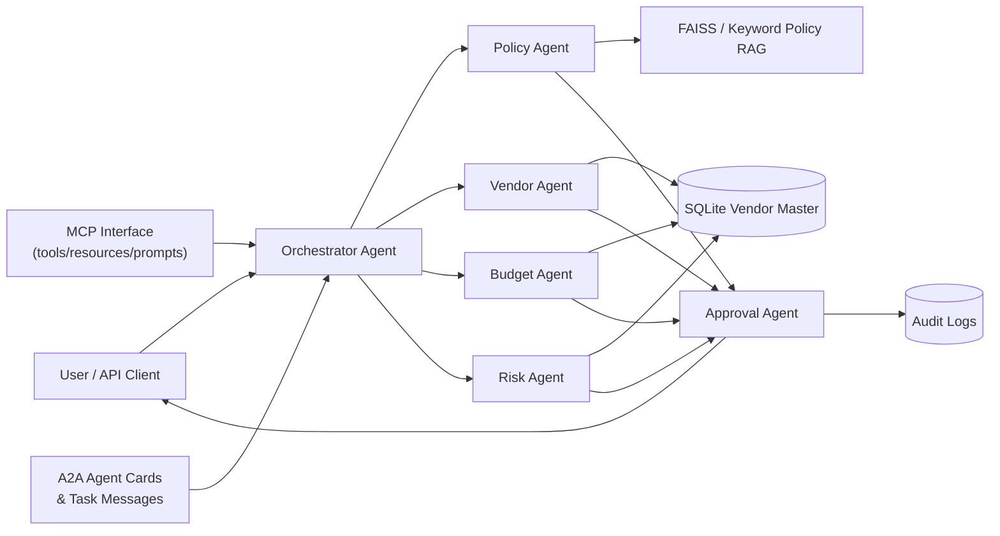
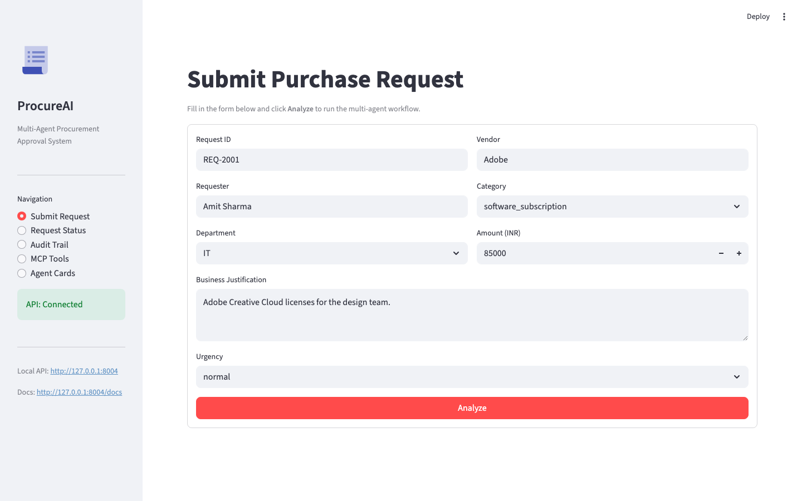
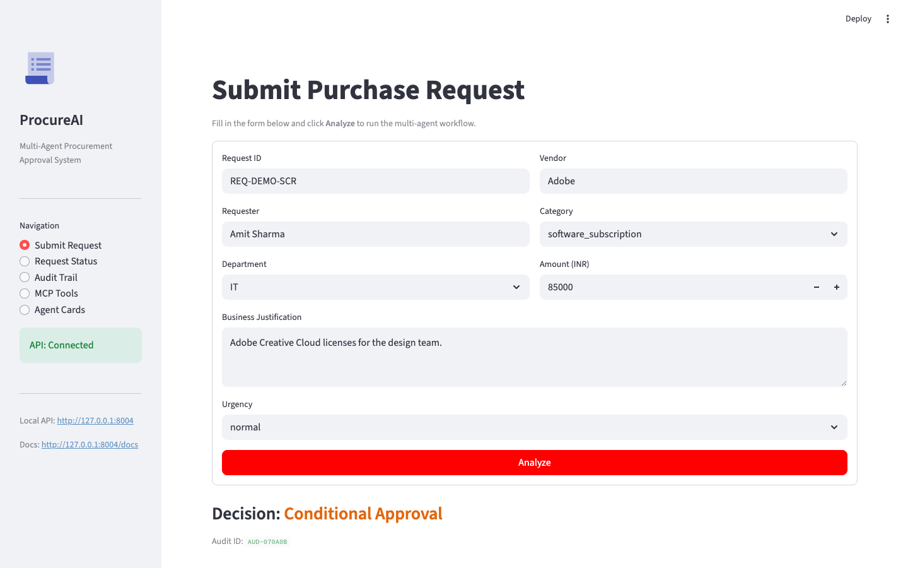
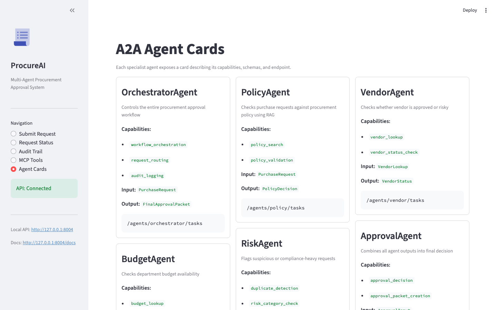
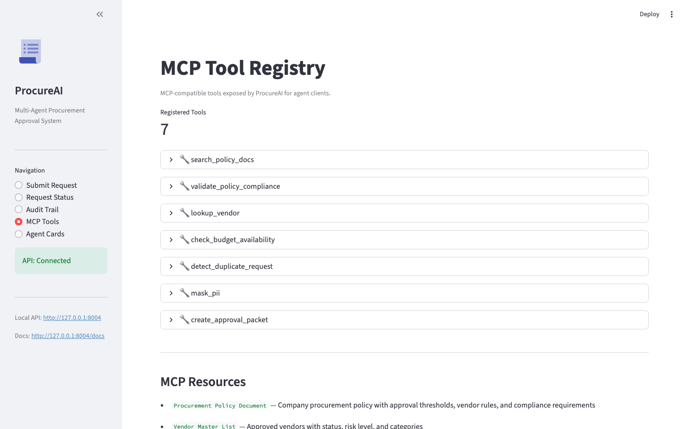

# ProcureAI: Multi-Agent Procurement Approval System

ProcureAI is a production-grade multi-agent procurement approval system implementing agent orchestration, MCP-style tool exposure, A2A-style agent communication, RAG-based policy checking, structured outputs, human-in-the-loop approval, audit logging, Docker deployment, and CI/CD.

## Business Use Case

Enterprise teams process purchase requests that require validation against procurement policy, vendor status checks, budget availability verification, compliance risk analysis, and multi-level approvals. Manual processing is slow, inconsistent, and lacks auditability.

**Client persona:** Procurement, finance, and operations teams at mid-to-large enterprises that handle 50-500+ purchase requests per month across multiple departments.

**Business value:**
- Reduces manual review time by automating policy checks, vendor validation, and budget verification.
- Reduces compliance risk through structured audit trails and policy-grounded decisions.
- Makes approval workflows transparent with evidence-backed decisions and required approver routing.

## Architecture



See [docs/architecture.md](docs/architecture.md) for local and Azure deployment diagrams.

## Local Quick Start

```bash
cd procureai
python3.12 -m venv .venv
source .venv/bin/activate
pip install -r requirements.txt
cp .env.example .env
python -c "from app.db.seed import seed_all; seed_all()"
python -c "from app.rag.ingest_policy import ingest_policy_document; ingest_policy_document()"
uvicorn app.main:app --host 127.0.0.1 --port 8004
```

The API starts at `http://127.0.0.1:8004`. OpenAPI docs at `http://127.0.0.1:8004/docs`.

### Submit a purchase request

```bash
curl -X POST http://127.0.0.1:8004/purchase-requests/analyze \
  -H "Content-Type: application/json" \
  -d '{
    "request_id": "REQ-1001",
    "department": "IT",
    "requester": "Amit Sharma",
    "vendor": "Adobe",
    "category": "software_subscription",
    "amount": 85000,
    "justification": "Need Adobe Creative Cloud licenses",
    "urgency": "normal"
  }'
```

### Check request status

```bash
curl http://127.0.0.1:8004/purchase-requests/REQ-1001
```

### View audit trail

```bash
curl http://127.0.0.1:8004/audit/REQ-1001
```

## Validation Workflow

1. Start the server and seed data.
2. Submit a standard purchase request and verify conditional approval with required approvers.
3. Submit a request with a blacklisted vendor and verify rejection.
4. Submit a request that exceeds department budget and verify rejection.
5. Check audit logs for full workflow traceability.
6. List MCP tools at `/mcp/tools` and query individual tools at `/mcp/tools/{tool_name}`.
7. Inspect A2A agent cards at `/agents/{agent_name}/card`.

See [demo/README.md](demo/README.md).

## Dashboard

The Streamlit dashboard provides a no-code interface for the approval workflow, agent inspection, and MCP tool registry.

```bash
# After starting the API server
streamlit run dashboard/app.py --server.port 8501
```

Dashboard opens at `http://localhost:8501`.

## Screenshots

**Submit Request — multi-agent workflow form:**



**Workflow result — decision, approvers, and evidence:**



**A2A Agent Cards — capabilities and schemas:**



**MCP Tool Registry:**



## Environment Variables

| Variable | Description | Default |
|----------|-------------|---------|
| `LLM_PROVIDER` | LLM provider: `rule-based`, `openai`, or `azure` | `rule-based` |
| `OPENAI_API_KEY` | OpenAI API key | empty |
| `OPENAI_MODEL` | OpenAI model name | `gpt-4o-mini` |
| `PROCUREAI_DB_PATH` | SQLite database path | `data/procureai.db` |
| `PROCUREAI_POLICY_PATH` | Policy document path | `data/procurement_policy.md` |
| `APPROVAL_MATRIX_PATH` | Approval matrix YAML path | `data/approval_matrix.yaml` |
| `HOST` | Server bind address | `127.0.0.1` |
| `PORT` | Server port | `8004` |
| `CORS_ORIGINS` | Allowed CORS origins | `*` |
| `JSON_LOGS` | Enable JSON structured logging | `false` |
| `LOG_LEVEL` | Logging level | `INFO` |

Azure placeholders (required only for Azure mode):

| Variable | Description |
|----------|-------------|
| `AZURE_OPENAI_ENDPOINT` | Azure OpenAI endpoint |
| `AZURE_OPENAI_KEY` | Azure OpenAI API key |
| `AZURE_OPENAI_CHAT_DEPLOYMENT` | Chat model deployment name |
| `AZURE_OPENAI_EMBED_DEPLOYMENT` | Embedding model deployment name |
| `AZURE_TENANT_ID` | Azure tenant ID |
| `AZURE_CLIENT_ID` | Service principal client ID |
| `AZURE_CLIENT_SECRET` | Service principal secret |
| `AZURE_KEY_VAULT_URL` | Key Vault URL |
| `APPLICATIONINSIGHTS_CONNECTION_STRING` | App Insights connection string |

## API Endpoints

| Method | Path | Description |
|--------|------|-------------|
| POST | `/purchase-requests/analyze` | Submit a purchase request for analysis |
| GET | `/purchase-requests/{id}` | Get request status and decision |
| GET | `/audit/{request_id}` | Get audit logs for a request |
| GET | `/agents` | List available A2A agents |
| GET | `/agents/{name}/card` | Get A2A agent card |
| POST | `/agents/{name}/tasks` | Send task to an A2A agent |
| GET | `/mcp/tools` | List MCP-compatible tools |
| POST | `/mcp/tools/{name}` | Execute an MCP tool |
| GET | `/mcp/resources` | List MCP resources |
| GET | `/mcp/prompts` | List MCP prompt templates |
| GET | `/mcp/prompts/{name}` | Get prompt template details |

See [docs/api.md](docs/api.md) for full API documentation.

## MCP Interface

The system exposes procurement capabilities through an MCP-compatible interface. Tools such as policy search, vendor lookup, budget validation, PII masking, and approval packet generation can be invoked by an agent client with typed inputs and structured outputs.

**MCP Tools:**
- `search_policy_docs` - Search procurement policy documents
- `validate_policy_compliance` - Validate a request against policy rules
- `lookup_vendor` - Look up vendor details by name
- `check_budget_availability` - Check department budget availability
- `detect_duplicate_request` - Detect duplicate purchase requests
- `mask_pii` - Mask personally identifiable information
- `create_approval_packet` - Create a complete approval packet

**MCP Resources:** `procurement_policy.pdf`, `vendor_master.csv`, `department_budget.csv`, `approval_matrix.yaml`, `sample_purchase_requests.json`

**MCP Prompts:** `procurement_policy_check_prompt`, `vendor_risk_review_prompt`, `approval_summary_prompt`

## A2A Communication

The system uses A2A-style agent communication where each specialist agent exposes an agent card, accepts structured tasks, and returns structured task responses. This allows independent agents to collaborate without hard-coding all logic into one monolithic service.

Each agent publishes:
- **Agent card** with name, description, capabilities, input/output schemas, and endpoint
- **Task messages** with task_id, source/target agents, task_type, and payload
- **Task responses** with status, result, and error information

## Metrics And Evaluation

- Request processing time per workflow
- Policy compliance pass/fail rate
- Budget check pass/fail rate
- Vendor risk distribution
- Audit log completeness
- Decision distribution (approved, conditional, rejected)

## Security Notes

- PII masking is applied to purchase request justifications during risk analysis.
- Vendor risk levels are tracked and blacklisted vendors are automatically rejected.
- Audit logs provide a complete, immutable trail of all agent actions.
- No credentials are stored in the codebase; all secrets use `.env.example` placeholders.
- CORS can be restricted to specific origins in production deployments.

## Azure Deployment Notes

The architecture supports local operation and Azure-backed deployment:

- SQLite to Azure Database for PostgreSQL.
- Local keyword-based RAG to Azure AI Search with semantic ranking.
- Mock LLM provider to Azure OpenAI GPT-4o.
- Single server to Azure Container Apps with auto-scaling.
- Local logs to Application Insights.

See [docs/deployment.md](docs/deployment.md).

## Cloud Portability

The system runs locally with Docker Compose and can be deployed to Azure Container Apps, AWS ECS/Fargate, or Kubernetes. LLM, vector store, database, and storage providers are abstracted behind environment variables.

## Implementation Summary

This implementation provides a credential-free local runtime with typed schemas, five specialist agents coordinated by an orchestrator, MCP-compatible tool exposure, A2A-style structured task communication, keyword-based RAG for procurement policy, SQLite persistence with audit logging, comprehensive test coverage, Docker deployment, CI/CD, and production-focused documentation.

Public release validation:

```bash
python scripts/prepare_public_release.py --destination ../procureai-public
```

External integration verification:

```bash
python scripts/verify_live_integrations.py
```
