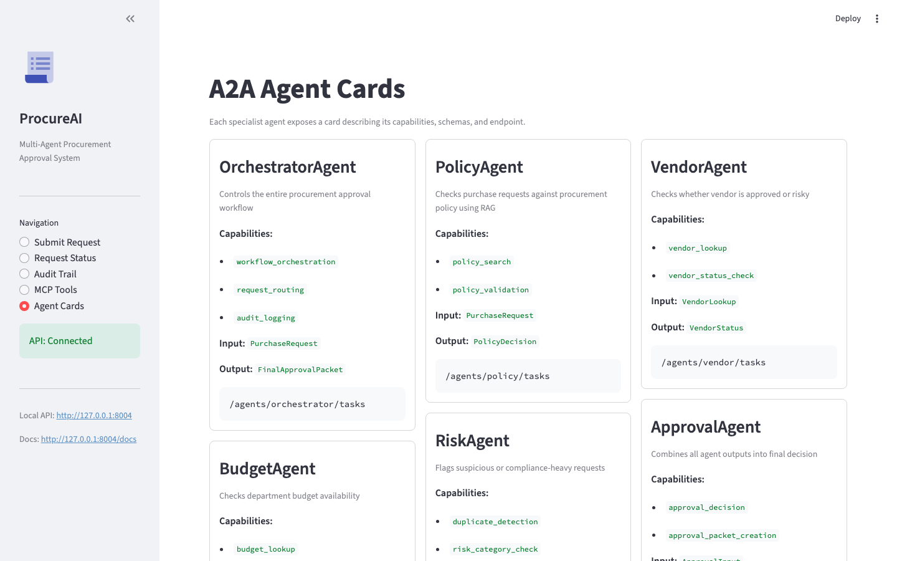

# Demo Walkthrough

## Scenario

This demo shows the procurement approval workflow for a real-world purchase request submitted by Amit Sharma from the IT department for Adobe Creative Cloud licenses.

## Prerequisites

```bash
cd procureai
python3.12 -m venv .venv
source .venv/bin/activate
pip install -r requirements.txt
cp .env.example .env
```

## Seed Reference Data

```bash
python -c "from app.db.seed import seed_all; seed_all()"
python -c "from app.rag.ingest_policy import ingest_policy_document; ingest_policy_document()"
```

## Start the API Server

```bash
uvicorn app.main:app --host 127.0.0.1 --port 8004
```

## Start the Dashboard (Optional)

```bash
streamlit run dashboard/app.py --server.port 8501
```

Dashboard opens at `http://localhost:8501`.

---

## API Demo

### Step 1: Submit a standard purchase request (conditional approval)

```bash
curl -X POST http://127.0.0.1:8004/purchase-requests/analyze \
  -H "Content-Type: application/json" \
  -d '{
    "request_id": "REQ-DEMO-001",
    "department": "IT",
    "requester": "Amit Sharma",
    "vendor": "Adobe",
    "category": "software_subscription",
    "amount": 85000,
    "justification": "Need Adobe Creative Cloud licenses for design team",
    "urgency": "normal"
  }'
```

Expected: `conditional_approval` with `department_manager` and `security_team` as required approvers.

### Step 2: Submit a request with a blacklisted vendor (rejection)

```bash
curl -X POST http://127.0.0.1:8004/purchase-requests/analyze \
  -H "Content-Type: application/json" \
  -d '{
    "request_id": "REQ-DEMO-002",
    "department": "IT",
    "requester": "Priya Nair",
    "vendor": "DataLeak Inc",
    "category": "data_services",
    "amount": 50000,
    "justification": "Data enrichment services",
    "urgency": "normal"
  }'
```

Expected: `rejected` — vendor is blacklisted.

### Step 3: Submit a request exceeding department budget (rejection)

```bash
curl -X POST http://127.0.0.1:8004/purchase-requests/analyze \
  -H "Content-Type: application/json" \
  -d '{
    "request_id": "REQ-DEMO-003",
    "department": "HR",
    "requester": "Rajan Mehta",
    "vendor": "Oracle",
    "category": "software_subscription",
    "amount": 300000,
    "justification": "Oracle HCM full-year license",
    "urgency": "high"
  }'
```

Expected: `rejected` — HR budget insufficient.

### Step 4: Check request status

```bash
curl http://127.0.0.1:8004/purchase-requests/REQ-DEMO-001
```

### Step 5: View audit trail

```bash
curl http://127.0.0.1:8004/audit/REQ-DEMO-001
```

### Step 6: List MCP tools

```bash
curl http://127.0.0.1:8004/mcp/tools
```

### Step 7: Inspect A2A agent card

```bash
curl http://127.0.0.1:8004/agents/policy/card
```

### Step 8: Send a direct A2A task

```bash
curl -X POST http://127.0.0.1:8004/agents/vendor/tasks \
  -H "Content-Type: application/json" \
  -d '{
    "task_id": "task-manual-001",
    "from_agent": "orchestrator",
    "to_agent": "vendor",
    "task_type": "vendor_check",
    "payload": {"vendor_name": "Adobe"}
  }'
```

---

## Screenshots

**Submit Request form — before submission:**


**Workflow result — conditional approval with required approvers and evidence:**


**A2A Agent Cards — each agent's capabilities and schemas:**



**MCP Tool Registry — tools, resources, and prompt templates:**


---

## What the Demo Proves

| Capability | Where Visible |
|------------|---------------|
| Multi-agent orchestration | Audit log shows each agent action in sequence |
| RAG policy retrieval | Policy findings include source clause |
| Vendor validation | Vendor status and risk flags returned |
| Budget checking | Remaining budget calculated |
| Risk flagging | Risk level and flags included |
| Structured decisions | Decision includes approvers, evidence, summary |
| MCP tool exposure | Tools listed at `/mcp/tools` with schemas |
| A2A agent communication | Agent cards at `/agents/{name}/card` |
| Audit trail | Full log at `/audit/{request_id}` |
