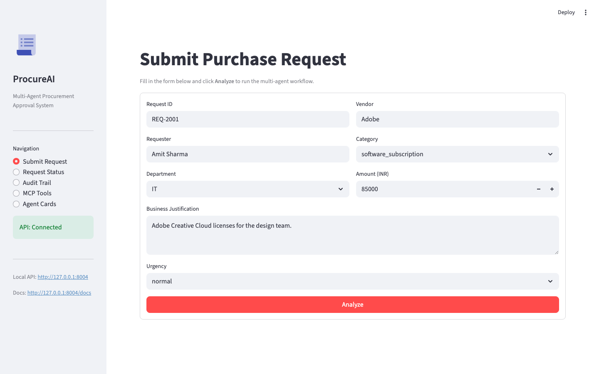
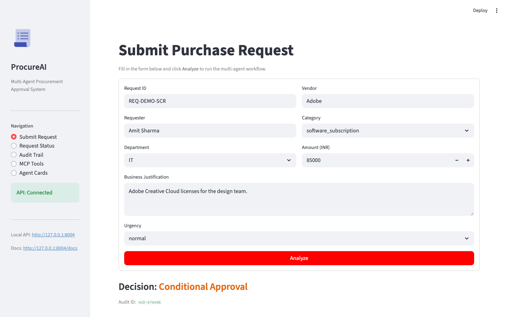
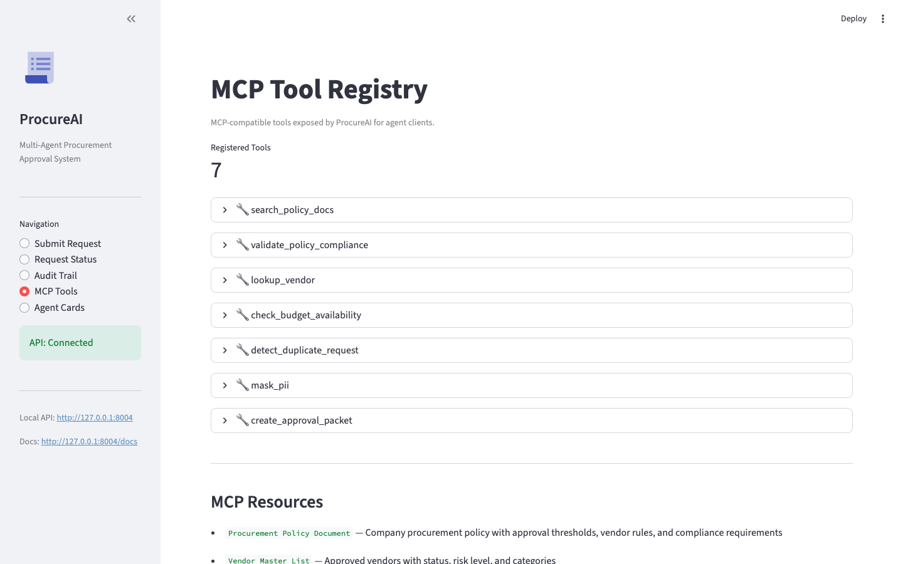

# Validation Walkthrough

## Scenario

This walkthrough covers the end-to-end procurement approval workflow across three representative request types: a standard conditional approval, a blacklisted vendor rejection, and a budget-exceeded rejection.

## Prerequisites

```bash
cd procureai
python3.12 -m venv .venv
source .venv/bin/activate
pip install -r requirements.txt
cp .env.example .env
```

## Initialize Reference Data

```bash
python -c "from app.db.seed import seed_all; seed_all()"
python -c "from app.rag.ingest_policy import ingest_policy_document; ingest_policy_document()"
```

## Start the API Server

```bash
uvicorn app.main:app --host 127.0.0.1 --port 8004
```

## Start the Dashboard (Optional)

```bash
streamlit run dashboard/app.py --server.port 8501
```

Dashboard opens at `http://localhost:8501`.

---

## Workflow Validation

### Step 1: Standard request — conditional approval

Submit a software subscription request. Policy requires manager approval for amounts above 25,000 INR; the software category triggers a mandatory security review.

```bash
curl -X POST http://127.0.0.1:8004/purchase-requests/analyze \
  -H "Content-Type: application/json" \
  -d '{
    "request_id": "REQ-2024-IT-0401",
    "department": "IT",
    "requester": "Amit Sharma",
    "vendor": "Adobe",
    "category": "software_subscription",
    "amount": 85000,
    "justification": "Adobe Creative Cloud annual licenses for the design team",
    "urgency": "normal"
  }'
```

Expected outcome: `conditional_approval` — required approvers: `department_manager`, `security_team`.

### Step 2: Blacklisted vendor — automatic rejection

Submit a request to a vendor that has been blacklisted in the vendor master. The Vendor Agent rejects the request immediately without proceeding to budget or policy checks.

```bash
curl -X POST http://127.0.0.1:8004/purchase-requests/analyze \
  -H "Content-Type: application/json" \
  -d '{
    "request_id": "REQ-2024-FIN-0402",
    "department": "Finance",
    "requester": "Arun Kumar",
    "vendor": "Veridata Analytics",
    "category": "data_services",
    "amount": 50000,
    "justification": "Financial data enrichment and analytics platform",
    "urgency": "normal"
  }'
```

Expected outcome: `rejected` — vendor is blacklisted.

### Step 3: Budget exceeded — rejection

Submit a request that exceeds the HR department's available budget. The Budget Agent rejects the request after the vendor check passes.

```bash
curl -X POST http://127.0.0.1:8004/purchase-requests/analyze \
  -H "Content-Type: application/json" \
  -d '{
    "request_id": "REQ-2024-HR-0403",
    "department": "HR",
    "requester": "Rahul Verma",
    "vendor": "Oracle",
    "category": "software_subscription",
    "amount": 300000,
    "justification": "Oracle HCM full-year enterprise license",
    "urgency": "high"
  }'
```

Expected outcome: `rejected` — HR department budget insufficient.

### Step 4: Retrieve request status

```bash
curl http://127.0.0.1:8004/purchase-requests/REQ-2024-IT-0401
```

### Step 5: Retrieve audit trail

```bash
curl http://127.0.0.1:8004/audit/REQ-2024-IT-0401
```

The audit log contains a sequential record of every agent action — orchestrator start, policy check, vendor check, budget check, risk check, and final approval — with timestamps.

### Step 6: Inspect the MCP tool registry

```bash
curl http://127.0.0.1:8004/mcp/tools
```

Returns all seven registered tools with typed input and output schemas.

### Step 7: Inspect an A2A agent card

```bash
curl http://127.0.0.1:8004/agents/policy/card
```

Returns the Policy Agent's capability declaration: name, description, capabilities, input/output schemas, and endpoint.

### Step 8: Send a direct A2A task

```bash
curl -X POST http://127.0.0.1:8004/agents/vendor/tasks \
  -H "Content-Type: application/json" \
  -d '{
    "task_id": "TASK-2024-001",
    "from_agent": "orchestrator",
    "to_agent": "vendor",
    "task_type": "vendor_check",
    "payload": {"vendor_name": "Adobe"}
  }'
```

Returns a structured task response with vendor status, risk level, and any risk flags.

---

## Screenshots

**Submit Request — multi-agent workflow form:**



**Workflow result — conditional approval with required approvers and agent evidence:**



**A2A Agent Cards — each agent's capabilities and schemas:**


**MCP Tool Registry — tools, resources, and prompt templates:**



---

## System Capabilities

| Capability | Validation Point |
|------------|-----------------|
| Multi-agent orchestration | Audit log shows each agent action in sequence |
| RAG policy retrieval | Policy findings include source clause reference |
| Vendor validation | Vendor status and risk flags returned per agent card |
| Budget verification | Remaining budget calculated against department allocation |
| Risk analysis | Risk level and category flags included in findings |
| Structured decisions | Decision packet includes approvers, evidence, and summary |
| MCP tool exposure | All tools listed at `/mcp/tools` with typed schemas |
| A2A agent communication | Agent cards served at `/agents/{name}/card` |
| Audit trail | Complete per-request log at `/audit/{request_id}` |
