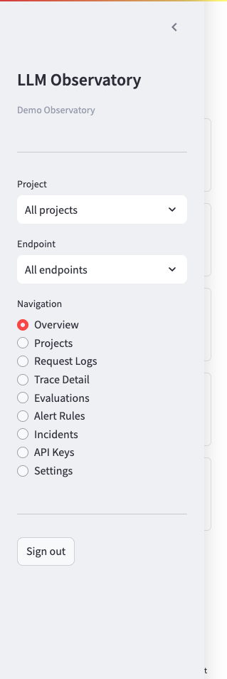
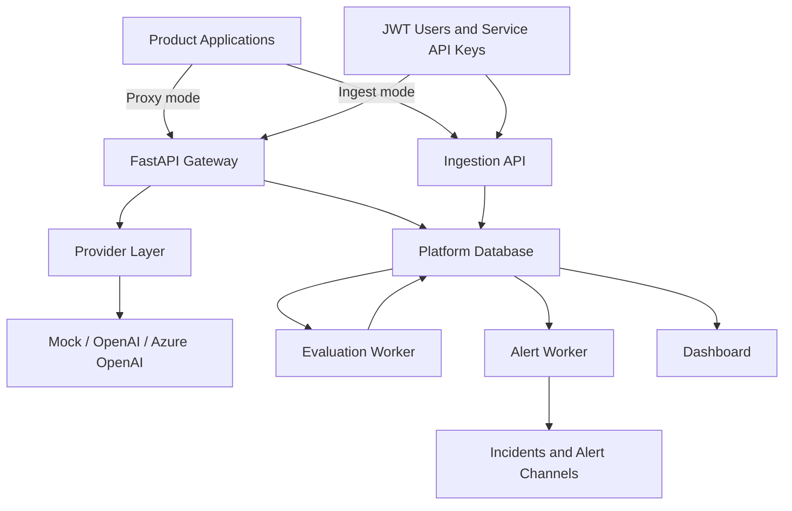
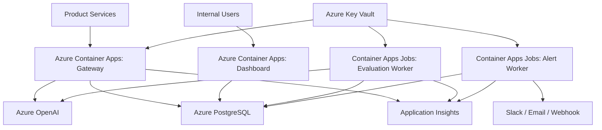

# LLM Production Monitoring

Enterprise-oriented AI engineering portfolio focused on production LLM observability, evaluation, alerting, and deployment readiness.

The primary implementation in this repository is [LLM Observatory](01-llm-observatory/README.md), a local-first FastAPI, Streamlit, SQLAlchemy, Alembic, and PostgreSQL-ready platform for monitoring LLM calls, latency, token usage, cost, hallucination risk, evaluation scores, alert rules, and incidents.

## Primary Project



LLM Observatory provides:

- Authenticated backend APIs with JWT user access and service API keys
- Organization-scoped projects, endpoints, request logs, traces, and metrics
- Mock, OpenAI, and Azure OpenAI provider modes
- Cost, latency, token, quality, and incident tracking
- Evaluation jobs for faithfulness, relevancy, hallucination risk, safety, and PII signals
- Alert rules for quality, latency, error rate, cost, token spikes, and provider failures
- Streamlit dashboard for customer-style local demos
- Docker Compose, Alembic migrations, tests, and GitHub Actions CI

## Architecture



## Forward Azure Deployment



## Repository Layout

| Path | Purpose |
| --- | --- |
| [01-llm-observatory](01-llm-observatory/README.md) | Production-shaped LLM observability platform |
| [02-enterprise-rag](02-enterprise-rag/README.md) | Enterprise RAG project brief and build folder |
| [03-ai-analytics-copilot](03-ai-analytics-copilot/README.md) | Analytics copilot project brief and build folder |
| [04-multi-agent-bpa](04-multi-agent-bpa/README.md) | Multi-agent business process automation project brief |
| [05-document-intelligence-workbench](05-document-intelligence-workbench/README.md) | Document intelligence workbench project brief |
| [06-domain-specific-copilot](06-domain-specific-copilot/README.md) | Domain-specific copilot project brief |
| [07-finetuning-evaluation-pipeline](07-finetuning-evaluation-pipeline/README.md) | Fine-tuning and evaluation pipeline project brief |
| [project_build_reference.md](project_build_reference.md) | Common engineering instructions for all projects |
| [social_media_playbook.md](social_media_playbook.md) | Professional posting plan for project progress |
| [user_project_requirements.md](user_project_requirements.md) | Standing requirements captured during the build |

## Quick Start

```bash
cd 01-llm-observatory
cp .env.example .env
uv venv .venv --python 3.11
source .venv/bin/activate
uv pip install -r requirements.txt
alembic upgrade head
python demo/seed_platform_demo.py
streamlit run dashboard/app.py --server.port 8510
```

Open the dashboard at `http://localhost:8510`.

Default local mode uses deterministic mock LLM responses and does not require Azure credentials. Azure OpenAI, Azure PostgreSQL, Key Vault, Container Apps, and Application Insights are documented as the forward production deployment path.

## Verification

```bash
cd 01-llm-observatory
pytest
```

GitHub Actions runs the same test suite on Python 3.11 and 3.12.
